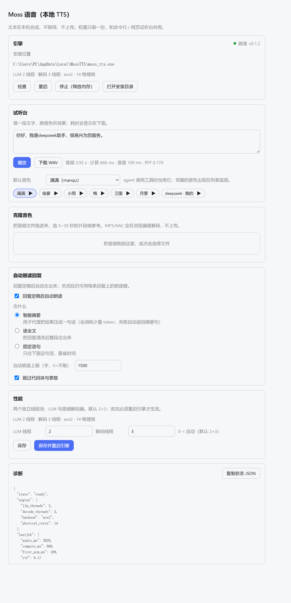

# dsh-plugin-moss-tts

[简体中文](README.zh-CN.md) · Version **0.2.0** · Apache-2.0 · [Engine repo](https://github.com/litterbit/dsh-moss-tts)

Local text-to-speech for DeepSeek Harness, powered by the MOSS-TTS-Nano-100M C++ CPU engine.
Everything is synthesized on this machine; text never leaves it, and the weights are installed
once and shared with the CLI and the web playground.



```
Harness assistant reply ──► auto-read / per-message read button
                                 │
                     POST /moss-tts/stream (same origin, no CORS)
                                 │
        host plugin: engine lifecycle + verified download + paced proxy
                                 │  stdin/stdout JSON
                 moss_tts.exe --stdio (resident, weights loaded once)
                                 │
            browser AudioWorklet ring buffer ──► speakers
```

## Requirements

| Item | Requirement |
|---|---|
| DeepSeek Harness | 0.2.1-rc or newer (client slot contract) |
| OS | Windows x64 (the engine ships for that platform only) |
| Disk | ~170 MB (engine + weights), installed once |

## Install

**Desktop app**: sidebar **Plugins** → **Add plugin** → paste

```
github:litterbit/dsh-plugin-moss-tts#main
```

**CLI profile** (a profile the desktop app does not own):

```bash
dsh plugin --profile <name> add github:litterbit/dsh-plugin-moss-tts#main
```

**Restart DSH** afterwards. You get a "Moss Speech" settings page, a speaker toggle at the left
of the composer, a read button on every assistant reply, and five `moss_tts_*` tools.

> Installing from a local checkout: `dsh plugin --profile <name> add D:\path\to\dsh-plugin-moss-tts`
> (an absolute path is required).

## First run: install the engine

Open **Settings → Moss Speech → Download engine**. The plugin fetches
`MossTTS-win-x64-full.zip` (~160 MB) from the
[engine releases](https://github.com/litterbit/dsh-moss-tts/releases), verifies it against the
release's `sha256sums.txt`, and extracts it into `%LOCALAPPDATA%\MossTTS`.

- Already installed via the CLI or the web playground? It is reused; nothing is downloaded twice.
- Downloads resume after an interruption; cancel removes only the partial file.
- **Follows your system proxy**: `HTTPS_PROXY` / `HTTP_PROXY` first, then the Windows Internet
  settings (`ProxyEnable` + `ProxyServer`, via a CONNECT tunnel). A machine whose browser can open
  GitHub needs no extra configuration; set `NO_PROXY=*` to force direct connections.
- Behind a blocked network, point `engineUrl` + `engineSha256` at a mirror in the plugin config,
  or set `autoDownload: false` and manage the install yourself.

## Usage

| Entry point | What it does |
|---|---|
| 🔊 left of the composer | Auto-read. Reads each reply when it settles, using the selected mode; while speaking the same button is ⏹ and stops it |
| 🔊 on a reply | Reads that reply only (whole text, ignores the auto-read limit) |
| Settings → Moss Speech | Engine state/threads/restart, default voice, **voice lab** (type text, preview any voice), **drag-and-drop clone**, three read modes, diagnostics |
| `moss_tts_say` | Agent-initiated speech (plays locally, or `save_to` writes a WAV); cloned voices are detected automatically |
| `moss_tts_voices` / `moss_tts_stop` / `moss_tts_clone` / `moss_tts_engine` | Voices (labels + default marker) / stop / clone (trims >20 s) / status, install, restart, unload |

Markdown is cleaned before speaking: fenced code and tables are skipped, links keep their text,
heading and list markers are stripped, and long replies are cut on a sentence boundary at the
auto-read limit (default 1500 characters, 0 = unlimited).

### Three read modes

| Mode | What is spoken | Cost |
|---|---|---|
| **Smart summary** (default) | A DSH subagent condenses the turn into one sentence (≤60 chars); only 200 chars of the question and 600 chars of the answer are sent | A few k tokens per turn (the child's own system prompt); replies under 80 chars are read as-is |
| **Full text** | The whole reply after cleaning (v0.1 behaviour) | Local compute only |
| **Fixed line** | One editable sentence, e.g. "Task complete." | Almost free |

If the summary fails (no subagent service, parent offline, timeout, error) it falls back to a
local extract (first sentence, zero tokens) and then to the fixed line — so you always hear
something. The child shows up in the subagent list as `moss-tts-summary`.

### Cloning without the CLI

The "Clone a voice" card is a drop zone: drop a WAV/MP3/M4A, the browser decodes it to 48 kHz with
`OfflineAudioContext`, draws the waveform, lets you drag a 1–20 second window, preview it, name it,
and create the voice. The file never leaves the machine — only the trimmed PCM WAV goes to the
local engine.

### Engine lifecycle and memory

- Nothing is preloaded: DSH start-up only loads the host module and the settings script (tens of KB),
  no engine process.
- `moss_tts.exe` starts on the first synthesis / voice list / clone (~1–2 s to load weights,
  ~250 MB resident afterwards).
- After **10 idle minutes** the engine is unloaded and the memory returned; the next synthesis
  starts it again. `preload: true` warms it at start-up, `idleUnloadMinutes: 0` never unloads.
- To not load the plugin at all, turn `dsh-plugin-moss-tts` off on the sidebar **Plugins** page
  (writes `disabled: true` into the profile patch); after a restart even the settings page is gone.

### Threads

The "Performance" card edits the two thread pools (LLM and decoder; 0 = auto, default 2+3) and
applies them with **Save and restart engine**. Thread counts change speed and heat, never the
audio, and land in the engine's own `%LOCALAPPDATA%\MossTTS\userdata\settings.json` so the CLI and
the web playground see the same values.


## Privacy

- Synthesis is fully local: no network, no uploaded text, no telemetry.
- The only outbound traffic is the engine download you trigger from the settings page.
- Cloned voices live under `%LOCALAPPDATA%\MossTTS\userdata\voices\user\`.

## How it relates to the CLI and the web playground

All three run the same `moss_tts.exe`, the same weights and the same data directory:

- CLI: `moss_tts.exe --text "hello" --out hello.wav`
- Web playground: double-click `moss_tts.exe` → `http://127.0.0.1:8759/`
- This plugin: no port; it spawns the resident engine over `--stdio`

Engine and plugin version independently: `engine.json` pins a release, falls back to the latest
one when that tag is gone, and always verifies the release's `sha256sums.txt`.

## Uninstall

In the desktop app, remove it from the sidebar **Plugins** page. For a CLI-managed profile:
`dsh plugin --profile <name> remove dsh-plugin-moss-tts`.

The weights are left in place (the CLI and the web playground still use them). Delete
`%LOCALAPPDATA%\MossTTS` to remove them too.

## Troubleshooting

| Symptom | Fix |
|---|---|
| Settings keeps showing "not installed" | Press "Re-check"; verify `%LOCALAPPDATA%\MossTTS\moss_tts.exe` and `models\` exist |
| Download fails / hash mismatch | Usually a proxy rewriting the body. Retry once; if it persists, set `engineUrl` + `engineSha256` in the plugin config |
| "Ready" but silent | The tab is muted, or the output device is wrong; click anywhere in the page once so the browser allows playback |
| Long replies are cut short | The auto-read limit (1500 chars) — raise it in settings, or use the reply's own read button |
| It keeps ~250 MB resident | The engine is a resident child; it unloads after 10 idle minutes, or press "Stop (free memory)", or lower `idleUnloadMinutes` |
| Smart summary is not used | Check the diagnostics JSON or `[summary]` in `plugin.log`; without the subagent service it degrades to `extract` |
| Thread changes do nothing | Press "Save and restart engine"; a stale value in `settings.json` is read back into the page first |
| Plugin does not appear | DSH must be restarted; `dsh --profile desktop --dump-config` should contain a row `id: moss-tts` |

## Development

```bash
node tools/build-client.mjs          # regenerate lib/client.js (committed; installs run no build)
node tools/build-client.mjs --check  # what CI uses to catch a stale bundle
node tools/ci.mjs                    # the same gate GitHub Actions runs
node --test tests/*.test.mjs         # no DSH required; engine tests skip without an engine
```

Host contract (verified against DSH 0.2.1-rc.2 on the development machine): `dsh.bundle.patch`
inserts one loader row for the host half; `dsh.client.platform = "web"` plus
`exports["./client"]` load the browser half; the host registers routes through
`ctx.get('webServer').register` and the client registers slots through `ctx.slots.inject`.
Nothing is imported from the host packages — tool definitions are plain objects with standard
JSON Schema.

## License

Apache-2.0. Model weights come from MOSS-TTS-Nano-100M (Apache-2.0) and are converted to the
engine's container format by the engine repo; this package ships **no** weights or binaries and
downloads them at runtime. See [NOTICE](NOTICE.md).
