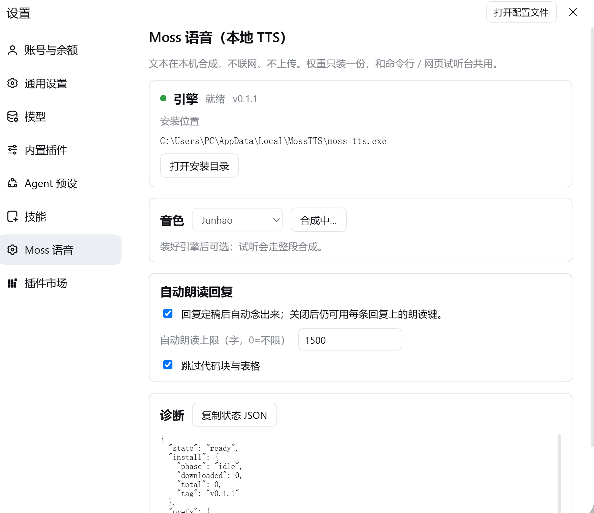

# dsh-plugin-moss-tts

[English](README.md) · 版本 **0.1.1** · Apache-2.0 · [引擎仓](https://github.com/litterbit/dsh-moss-tts)

给 DeepSeek Harness 用的**本地 TTS**插件：用 MOSS-TTS-Nano-100M 的 C++ CPU 引擎朗读助手回复。
全部在本机计算，文本不出机器；权重只装一份，和命令行、网页试听台共用。



```
Harness 助手回复 ──► 自动朗读 / 每条回复的朗读键
                        │
              POST /moss-tts/stream（同源，无 CORS）
                        │
       host 插件：引擎生命周期 + 下载校验 + 定速代理
                        │  stdin/stdout JSON
              moss_tts.exe --stdio（常驻，权重只加载一次）
                        │
        浏览器 AudioWorklet 环形缓冲 ──► 扬声器
```

## 需要什么

| 项 | 要求 |
|---|---|
| DeepSeek Harness | 0.2.1-rc 及以上（客户端 slot 契约） |
| 系统 | Windows x64（引擎目前只发布这一个平台） |
| 磁盘 | 约 170 MB（引擎 + 权重），装一次 |

## 安装

**桌面版**：侧栏「插件」→「添加插件」→ 粘贴

```
github:litterbit/dsh-plugin-moss-tts#main
```

> 桌面版的 profile 由应用独占管理，`dsh plugin` 命令行会明确拒绝（`profile ... is managed
> exclusively by the Electron application`），所以别用命令行装。

**命令行 profile**（非 Electron 托管）：

```bash
dsh plugin --profile <name> add github:litterbit/dsh-plugin-moss-tts#main
```

装完**重启 DSH**。插件会出现在设置里（「Moss 语音」），输入框左侧多一个喇叭开关，
每条助手回复的操作栏多一个朗读键，工具表里多 5 个 `moss_tts_*` 工具。

> 想先试本地目录：`dsh plugin --profile <name> add D:\path\to\dsh-plugin-moss-tts`
> （必须是绝对路径）。

## 第一次使用：装引擎

打开 **设置 → Moss 语音 → 下载引擎**。插件从
[引擎 Release](https://github.com/litterbit/dsh-moss-tts/releases) 拉
`MossTTS-win-x64-full.zip`（约 160 MB），用同一发布里的 `sha256sums.txt` 校验后解压到
`%LOCALAPPDATA%\MossTTS`。

- 已经用命令行或网页试听台装过？插件直接复用，不会重复下载。
- 下载可以断点续传；取消只删半包。
- **自动跟系统代理**：先看 `HTTPS_PROXY` / `HTTP_PROXY` 环境变量，没有就读 Windows 的
  Internet 设置（`ProxyEnable` + `ProxyServer`，走 CONNECT 隧道）。所以"浏览器能打开 GitHub"
  的机器不需要额外配置；想强制直连，设 `NO_PROXY=*` 或把代理关掉。
- 连不上 GitHub 时，可以在 `cordis.patch.yml` 的 config 里换 `engineUrl` + `engineSha256`
  （例如镜像站），或用 `autoDownload: false` 完全手动管理。

## 怎么用

| 入口 | 说明 |
|---|---|
| 输入框左侧 🔊 | 自动朗读开关。开着时，每条回复定稿后自动念；再点（朗读中变 ⏹）立刻停 |
| 每条回复的 🔊 | 只念这一条。默认念全文，不受"自动朗读上限"影响 |
| 设置 → Moss 语音 | 音色、语速（引擎默认采样参数）、自动朗读上限、跳过代码块、试听、引擎状态与路径 |
| 工具 `moss_tts_say` | agent 主动朗读（本机播放，或 `save_to` 只落盘） |
| 工具 `moss_tts_voices` / `moss_tts_stop` / `moss_tts_clone` / `moss_tts_engine` | 音色列表 / 停止 / 克隆音色 / 引擎状态与安装 |

朗读前会清洗 Markdown：代码块和表格不念，链接只念文字，标题与列表符号去掉，
按句末标点截断到「自动朗读上限」（默认 1500 字，0 = 不限）。

## 隐私

- 合成完全在本机：不联网、不上传文本、不收集使用数据。
- 唯一的出网行为是**你点下载时**从 GitHub 拉引擎包，以及可选的版本检查；关掉自动下载就没有。
- 用户音色（`moss_clone`）写在本机 `%LOCALAPPDATA%\MossTTS\userdata\voices\user\`。

## 和命令行 / 网页试听台的关系

三者跑同一个 `moss_tts.exe`、同一份权重、同一个数据目录：

- 命令行：`moss_tts.exe --text "你好" --out hello.wav`
- 网页试听台：双击 `moss_tts.exe`（无参数）打开 `http://127.0.0.1:8759/`
- 本插件：不需要端口，插件自己 spawn 常驻子进程走 `--stdio`

引擎和插件各自独立升级：插件在 `engine.json` 里钉一个发布版本，找不到时回退到最新发布，
并始终按发布页的 `sha256sums.txt` 校验。

## 卸载

桌面版在**侧栏「插件」**里卸载；命令行 profile（非 Electron 托管）也可以用
`dsh plugin --profile <name> remove dsh-plugin-moss-tts`。

插件不会删权重（命令行 / 网页试听台还在用）。要彻底清掉：删掉 `%LOCALAPPDATA%\MossTTS`。

## 常见问题

| 现象 | 处理 |
|---|---|
| 设置页一直「未安装」 | 点「重新检测」；确认 `%LOCALAPPDATA%\MossTTS\moss_tts.exe` 与 `models\` 都在 |
| 下载失败 / 校验不通过 | 多半是代理改写了内容。重试一次；仍然失败就在 config 里给 `engineUrl` + `engineSha256` 换源 |
| 朗读没有声音但设置页显示就绪 | 浏览器标签页被静音或系统输出设备不对；点一下页面任意处让浏览器允许自动播放 |
| 长回复只念了一部分 | 默认上限 1500 字，改设置里的「自动朗读上限」或点那条回复上的朗读键 |
| 提示引擎版本过旧 | 删掉 `%LOCALAPPDATA%\MossTTS\models` 后重新点下载，升级权重 |
| 插件没出现 | 安装后必须重启 DSH；`dsh --profile desktop --dump-config` 里应能看到一行 `id: moss-tts` |

## 开发

```bash
node tools/build-client.mjs          # 生成 lib/client.js（产物进仓库，安装时不构建）
node tools/build-client.mjs --check  # CI 用它拦"忘了重新生成"
node --test tests/*.test.mjs         # 不需要 DSH；真引擎的两个用例没有引擎会自动跳过
```

宿主契约（本机 DSH 0.2.1-rc.2 实测）：`dsh.bundle.patch` 一行 `insert` 挂 host 半边，
`dsh.client.platform = "web"` + `exports["./client"]` 挂浏览器半边；host 用
`ctx.get('webServer').register` 开路由，client 用 `ctx.slots.inject` 注册 slot。
没有从宿主包里 import 任何东西——工具定义是标准 JSON Schema 的普通对象。

## 许可与来源

Apache-2.0。模型权重来自 MOSS-TTS-Nano-100M（Apache-2.0），由引擎仓转换为自有容器格式；
本插件**不包含**任何权重或二进制，只在运行时下载。详见 [NOTICE](NOTICE.md)。
